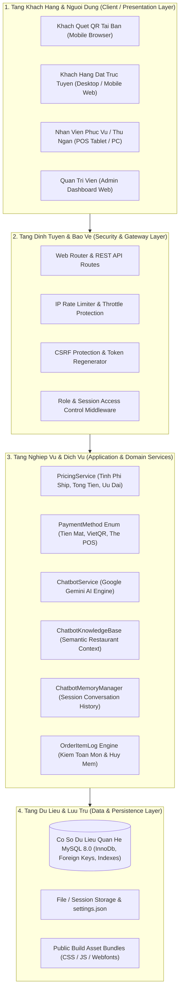
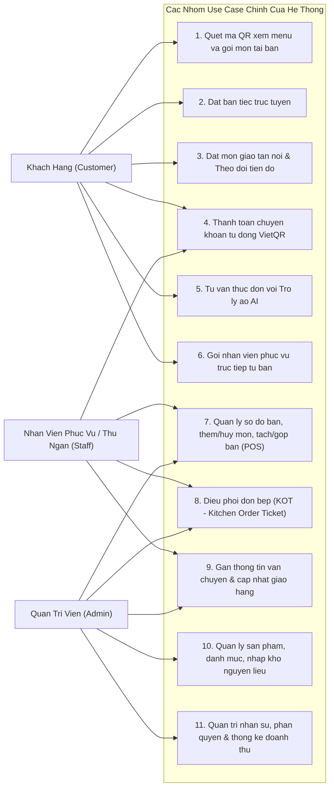
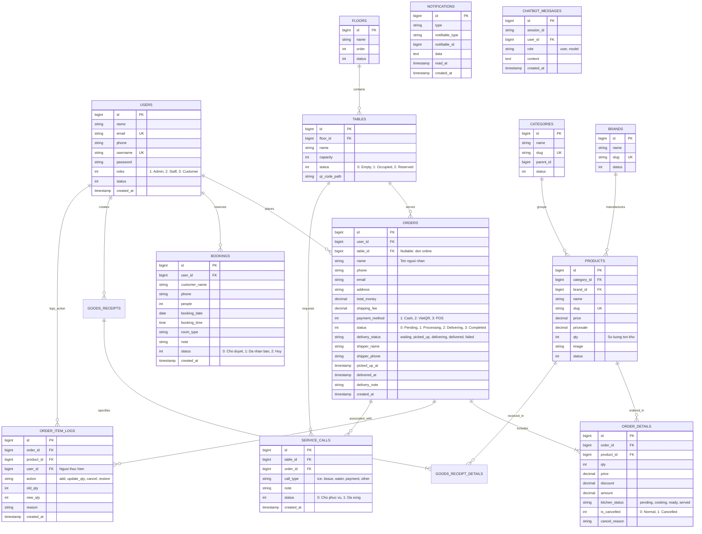
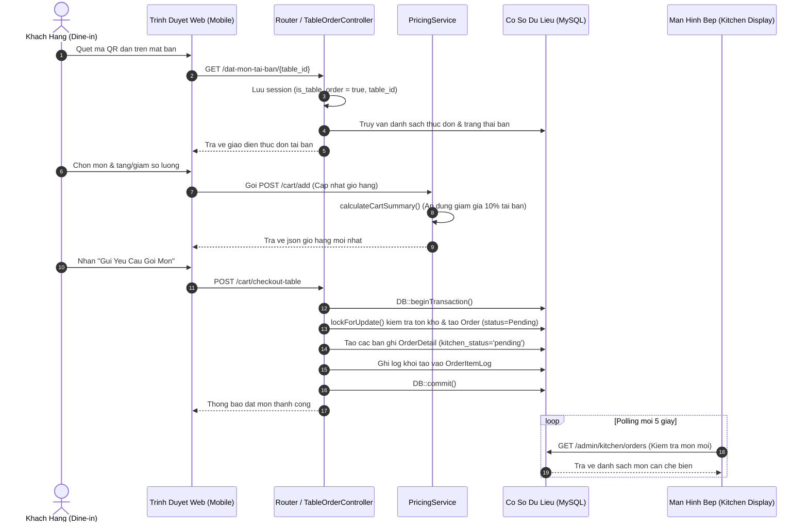
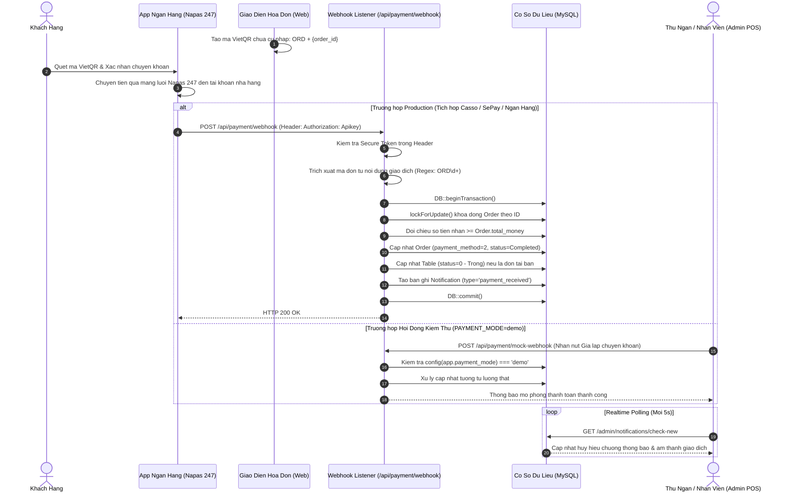
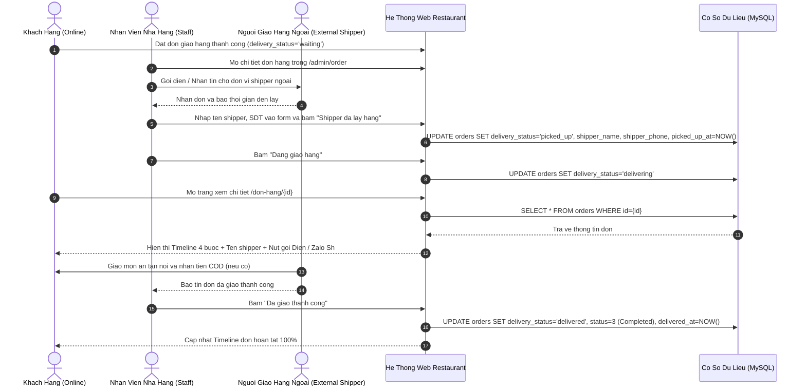

# BAO CAO KIEN TRUC VA SO DO HE THONG THIET KE
## HE THONG QUAN LY NHA HANG, POS VA GOI MON QR CIVILIZE RESTAURANT

---

### PHAN 1: TONG QUAN KIEN TRUC HE THONG (SYSTEM ARCHITECTURE OVERVIEW)

He thong CIVILIZE Restaurant duoc xay dung theo mo hinh **Kien truc Da tang Nguyen khoi hien dai (Modern Modular Monolith MVC)** tren nen tang **Laravel 11**, **PHP 8.2**, ket hop cong nghe ket xuat phia may chu (Server-Side Rendering voi Blade Templates), xu ly dong bo tai nguyen cuc bo (Local Asset Bundling voi Vite, Tailwind CSS va Font Awesome 6) va co che trao doi du lieu thoi gian thuc nhe (Lightweight Realtime Polling & Asynchronous REST API).



---

### PHAN 2: SO DO USE CASE TONG THE VA PHAN RA CHI TIET

#### 1. So Do Use Case Tong The (General System Use Cases)



#### 2. Phan Ra Use Case Theo Tung Tac Nhan (Actor Breakdown)

* **Tac nhan Khach hang tai ban:**
  * Quet ma QR doc tai cho (chua dinh danh ban, tang).
  * Xem thuc don danh muc, chi tiet nguyen lieu va gia niem yet.
  * Them mon vao gio hang tai ban, ap dung uu dai ban tiec.
  * Gui yeu cau goi mon vao hang doi bep.
  * Gui tin hieu yeu cau phuc vu (them da, khan lanh, bat dia, cham nuoc, goi thanh toan).
  * Quet ma VietQR dong chua noi dung thanh toan de tra tien.
* **Tac nhan Khach hang dat truc tuyen:**
  * Dang ky / Dang nhap tai khoan xac thuc.
  * Dat ban truoc (chon so luong nguoi, gio den, phong VIP, ghi chu).
  * Chon mon giao tan noi, he thong tu dong tinh phi van chuyen dua theo ban kinh va nguong mien phi hoa don tu `settings.json`.
  * Theo doi timeline hanh trinh don hang (Da dat -> Dang chuan bi -> Da ban giao shipper -> Dang giao -> Hoan tat) va nut lien he goi dien / Zalo shipper truc tiep.
* **Tac nhan Nhan vien:**
  * Xem truc quan trang thai ban (Trong, Dang su dung, Co khach dat truoc).
  * Thao tac chuyen ban, gop ban, in hoa don tam tinh.
  * Tiep nhan mon moi tai man hinh Bep KOT, doi trang thai mon (Cho che bien -> Dang nau -> Da len ban).
  * Huy mon an kem ly do ghi nhan vao `order_item_logs` (Soft Cancellation).
  * Nhap thong tin don vi van chuyen ngoai (ten shipper, so dien thoai, ghi chu) va bam chuyen doi tien do giao hang.
* **Tac nhan Quan tri vien:**
  * Toan quyen thao tac phan he POS va bep.
  * Thiet lap tham so he thong trong `settings.json` (phi ship, nguong freeship, ngan hang VietQR, hotline nha hang).
  * Quan ly tai khoan nhan vien, phan quyen truy cap.
  * Quan ly danh muc, san pham, phieu nhap kho, ton kho nguyen lieu.
  * Xem bao cao doanh thu, xuat file Excel thong ke theo moc thoi gian.

---

### PHAN 3: SO DO CO SO DU LIEU QUAN HE (ENTITY RELATIONSHIP DIAGRAM - ERD)

Co so du lieu thiet ke chuan hoa theo dang chuan 3 (3NF), ho tro rang buoc toan ven khoa ngoai (Foreign Keys), khoa duy nhat (Unique) va chi muc toi uu hoa truy van (Indexes):



---

### PHAN 4: SO DO TUAN TU CAC NGHIEP VU TRONG YEU (SEQUENCE DIAGRAMS)

#### 1. Quy Trinh Goi Mon Tai Ban Bang Ma QR (Dine-in QR Ordering Flow)



#### 2. Quy Trinh Thanh Toan Tu Dong Chuyen Khoan VietQR (VietQR Automated Payment)



#### 3. Quy Trinh Dieu Phoi Giao Hang Khong Can Role Shipper Rieng



---

### PHAN 5: PHAN TICH CHI TIET KIEN TRUC BAO MAT VA TOAN VEN DU LIEU

He thong ap dung cac tieu chuan phong thu chieu sau (Defense-in-Depth) de bao ve toan ven du lieu va ngan chan cac lo hong web:

1. **Kiem soat Dong thoi & Chong Tranh Chap Du Lieu (Pessimistic Locking & ACID Transactions):**
   * Trong tat ca cac nghiep vu nhay cam: dat hang tru ton kho, xac nhan webhook thanh toan, gop ban, doi trang thai mon, he thong luon boc trong `DB::beginTransaction()` ket hop `lockForUpdate()`.
   * Dam bao neu co nhieu luong cung luc truy cap (vi du 2 nhan vien cung bam thanh toan 1 ban, hoac 2 khach hang cung dat mon cuoi cung trong kho), cac transaction se duoc xep hang tuan tu, triet tieu hoan toan hien tuong Deadlock va Race Condition.

2. **Kiem Toan Mon An & Co Che Huy Mem (Soft Cancellation & Audit Trail):**
   * Khi mon an da duoc gui vao bep che bien, he thong cam tuyet doi lenh `DELETE` vat ly khoi bang `order_details`.
   * Mung huy mon su dung co che danh dau `is_cancelled = 1` kem `cancel_reason`. Dong thoi moi thao tac sua so luong, huy mon deu duoc he thong tu dong ghi vao bang `order_item_logs` luu lai ID nhan vien thao tac, so luong truoc/sau va ly do.

3. **Chong Tan Cong Chuyen Huong Mo (Open Redirect Protection):**
   * Ham xac thuc `AuthController::login()` su dung co che kiem duyet chuoi chuyen huong noi bo:
     ```php
     if ($redirectUrl && str_starts_with($redirectUrl, '/') && !str_starts_with($redirectUrl, '//')) {
         return redirect($redirectUrl);
     }
     return redirect()->route('home');
     ```
   * Ngan chan triet de ke tan cong chen URL ngoai doc hai (vi du: `?redirect=https://evil-phishing.com`) de lua dao nguoi dung sau khi dang nhap.

4. **Co Che Tu Dong Lam Moi Token CSRF Cho Chatbot & SPA:**
   * Thay vi loai bo kiem tra CSRF (lam tang nguy co gia mao yeu cau giua cac trang web), he thong cung cap endpoint bao mat `/refresh-csrf`.
   * Chatbot JavaScript tu dong goi endpoint nay de cap nhat token hop le truoc moi phien gui hoi thoai, giai quyet dut diem loi `419 Page Expired` tren hosting cong khai ma van duy tri lop la chan CSRF tuyet doi.

5. **Thu Hep Danh Sach Proxy Tin Cay (Trusted Proxies Narrowing):**
   * Trong `bootstrap/app.php`, he thong khong su dung cau hinh mac dinh nguy hiem `trustProxies(at: '*')` von cho phep gia mao header `X-Forwarded-For`.
   * He thong su dung bien moi truong `TRUSTED_PROXIES` voi dai IP xac dinh ro rang cua he thong Reverse Proxy / Cloudflare, bao ve do chinh xac cua co che Rate Limiting theo dia chi IP thuc cua client.

6. **Bao Ve Quyen Rieng Tu & An Toan Du Lieu Tro Ly Ao AI (Chatbot Security & Privacy):**
   * **Che giau du lieu nhay cam (PII Masking):** So dien thoai va ten khach hang trong du lieu phan hoi cua Chatbot duoc che giau mot phan (vi du: `098***4321`) de tranh ro ri thong tin ca nhan.
   * **Phan quyen tra cuu don hang:** Chatbot chi cho phep tra cuu don hang khi khach hang cung cap chinh xac ca Ma don hang va So dien thoai trung khop voi co so du lieu.
   * **Phong chong Dau doc Ho so (Profile Poisoning):** Co che `ChatbotMemoryManager` phan tach ro rang giua Context thuc don va du lieu nguoi dung nhap, su dung cac khuon mau Prompt chat che ngan chan tan cong Prompt Injection.
